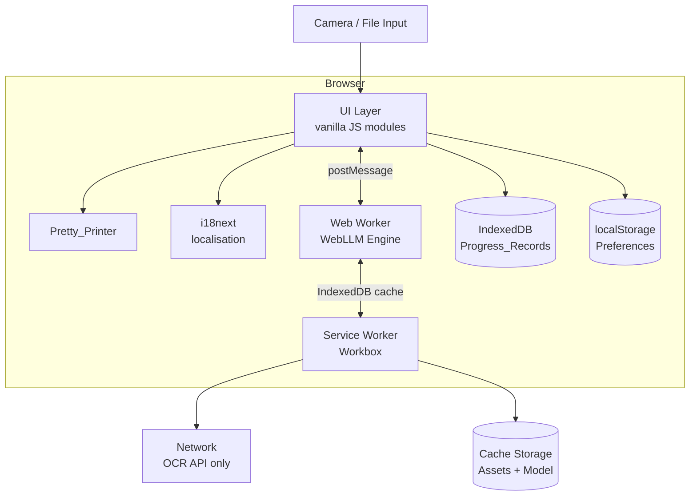

# Design Document

## Overview

Aura is a Progressive Web App (PWA) offline AI tutor for Malaysian students aged 10–16. The core flow is: student photographs or uploads a math problem → EasyOCR extracts the text → an on-device language model (via WebLLM) classifies the topic and generates step-by-step guidance → the student practises with generated exercises → progress is persisted locally.

The app is built with Vite + vite-plugin-pwa (Workbox) for offline support, plain JavaScript (ES modules) for the UI layer, and i18next for Bahasa Malaysia / English localisation. All AI tutoring runs entirely on-device after first load using WebLLM; only OCR requires a network call.

**Key design decisions:**

- **WebLLM (Phi-3.5-mini-instruct, MLC quantised)** for on-device inference — runs in a Web Worker via WebGPU, falls back to WASM if WebGPU is unavailable. Chosen over cloud APIs to meet the offline requirement and avoid recurring API costs.
- **i18next** for i18n — battle-tested, framework-agnostic, works as a plain ES module, supports JSON translation files that can be pre-cached by the service worker.
- **IndexedDB (via `idb` wrapper)** for Progress_Records — localStorage is limited to ~5 MB and is synchronous; IndexedDB handles the 10,000-record requirement without blocking the main thread. localStorage is retained only for the small Language_Preference and update-dismissed flags.
- **Workbox via vite-plugin-pwa** for service worker — provides cache-first and network-first strategies with minimal boilerplate, integrates cleanly with the Vite build pipeline.

---

## Architecture



The service worker intercepts all requests:
- **Cache-first** → static assets (JS, CSS, HTML, icons, translation JSON)
- **Network-first with offline fallback** → Roboflow OCR endpoint
- **Cache-first with update-in-background** → AI model shards (large binary files served from CDN; cached in `Cache Storage` on first download)

The WebLLM engine runs in a dedicated Web Worker so model inference never blocks the UI thread.

---

## Components and Interfaces

### 1. `CaptureModule` (`src/capture/`)

Handles camera invocation and file upload.

```js
// src/capture/captureModule.js
export async function captureFromCamera(): Promise<File>
export async function captureFromFile(input: HTMLInputElement): Promise<File>
export function validateFile(file: File): { valid: boolean; error?: string }
// validateFile checks: MIME type in ['image/jpeg','image/png','image/heic'], size <= 10 MB
```

### 2. `OCRService` (`src/backend/fetchOCR.js`)

Wraps the Roboflow EasyOCR serverless endpoint. Converts the existing `fetchOCR.jsx` stub into a proper module.

```js
// src/backend/fetchOCR.js
export async function runOCR(imageFile: File): Promise<OCRResult>
// Returns: { text: string, confidence: number }
// Throws: OCRTimeoutError (>15 s), OCRNetworkError, OCRLowConfidenceError (confidence < 0.85)
```

The image is converted to a base64 data URL before submission to match the Roboflow workflow's `"type": "url"` input format.

**Response normalisation:** The Roboflow EasyOCR workflow returns an array of detection objects `[{ text, confidence, bbox }]`. The service concatenates `text` fields (space-separated) and uses the minimum `confidence` as the aggregate confidence score.

### 3. `PrettyPrinter` (`src/formatting/prettyPrinter.js`)

Transforms raw OCR output and AI-generated text into consistently formatted math notation.

```js
// src/formatting/prettyPrinter.js
export function formatProblemText(raw: string): string
export function formatStepText(raw: string): string
// Substitution rules (applied in order):
// 1. Multiplication: * → ×, x (ambiguous) resolved by context
// 2. Division: / between numerals → ÷ (kept as a/b for fraction display)
// 3. Exponentiation: ** or ^ → x^n  
// 4. Square root: sqrt(...) preserved as-is
// 5. Subscripts: _ → x_n
```

### 4. `TutorEngine` (`src/tutor/`)

Orchestrates communication with the WebLLM Web Worker.

```js
// src/tutor/tutorEngine.js
export async function classifyProblem(problemText: string): Promise<Classification>
// { topic: string, curriculumLevel: CurriculumLevel, confidence: number }

export async function generateSolution(problemText: string, topic: string): Promise<Step[]>
// Step: { number: number, working: string, explanation: string }

export async function generateHint(step: Step, hintIndex: number): Promise<string>
// hintIndex 0-2 (max 3 hints per step)

export async function generateExercises(topic: string, level: CurriculumLevel, count: number): Promise<Exercise[]>
// Exercise: { id: string, prompt: string, answerFormat: string, answer: string }

export async function evaluateAnswer(exercise: Exercise, studentAnswer: string): Promise<Feedback>
// Feedback: { correct: boolean, explanation: string }
```

The worker is initialised once on app load via `new Worker(new URL('./tutorWorker.js', import.meta.url), { type: 'module' })`. A message-passing protocol (request/response correlated by `requestId`) is used.

**Model:** `Phi-3.5-mini-instruct-q4f16_1-MLC` — approximately 2.4 GB download, cached in Cache Storage by the service worker after the first load. Chosen for its strong math reasoning at a small footprint suitable for mobile WebGPU.

**System prompt** (language-aware, injected per request):
```
You are Aura, a math tutor for Malaysian students (KSSR/KSSM syllabus). 
Always reply in {language}. Use × for multiplication, ÷ for division, x^n for exponents, a/b for fractions.
Keep each step explanation under 40 words. Never reveal the answer in a hint.
```

### 5. `ProgressStore` (`src/progress/progressStore.js`)

Manages Progress_Records via IndexedDB.

```js
// src/progress/progressStore.js
export async function recordExerciseResult(result: ExerciseResult): Promise<void>
// ExerciseResult: { topic, curriculumLevel, correct: boolean, timestamp: number }

export async function getSummary(): Promise<TopicSummary[]>
// TopicSummary: { topic, level, totalAttempts, firstAttemptCorrect, accuracyPercent }

export async function clearAll(): Promise<void>
```

IndexedDB schema:
- **Database**: `aura-progress` v1
- **Object store**: `records` — keyPath `id` (auto-increment), indexed on `topic`
- **Eviction**: Before each write, if `records.count() >= 10000`, the record with the lowest `id` (oldest) is deleted.

### 6. `I18nService` (`src/i18n/`)

Wraps i18next with two JSON translation namespaces (`ui` and `tutor`).

```js
// src/i18n/i18nService.js
export async function initI18n(): Promise<void>
export function t(key: string, options?: object): string
export async function setLanguage(lang: 'en' | 'ms'): Promise<void>
export function getCurrentLanguage(): 'en' | 'ms'
```

Translation files are static JSON assets pre-cached by the service worker:
- `src/i18n/locales/en/ui.json`
- `src/i18n/locales/en/tutor.json`
- `src/i18n/locales/ms/ui.json`
- `src/i18n/locales/ms/tutor.json`

### 7. `ServiceWorkerManager` (`src/sw/`)

Configured via `vite.config.js` using `vite-plugin-pwa`. The service worker is generated by Workbox at build time.

Key Workbox runtime caching rules:
```js
// vite.config.js (workbox section)
runtimeCaching: [
  {
    // Network-first for OCR API
    urlPattern: /serverless\.roboflow\.com/,
    handler: 'NetworkFirst',
    options: { networkTimeoutSeconds: 15, cacheName: 'ocr-api-cache' }
  },
  {
    // Cache-first for WebLLM model shards from CDN
    urlPattern: /cdn\.jsdelivr\.net.*mlc-llm/,
    handler: 'CacheFirst',
    options: { cacheName: 'model-cache', expiration: { maxEntries: 200 } }
  }
]
```

---

## Data Models

```js
// Shared types (src/types.js)

/**
 * @typedef {'Year4'|'Year5'|'Year6'|'Form1'|'Form2'|'Form3'|'Form4'} CurriculumLevel
 */

/**
 * @typedef {Object} OCRResult
 * @property {string} text - concatenated recognised text
 * @property {number} confidence - aggregate confidence [0, 1]
 */

/**
 * @typedef {Object} Classification
 * @property {string} topic - e.g. "Fractions"
 * @property {CurriculumLevel} curriculumLevel
 * @property {number} confidence - model confidence [0, 1]
 */

/**
 * @typedef {Object} Step
 * @property {number} number - 1-based index
 * @property {number} total - total steps in solution
 * @property {string} working - the mathematical working
 * @property {string} explanation - plain-language explanation (≤ 40 words)
 */

/**
 * @typedef {Object} Exercise
 * @property {string} id - UUID v4
 * @property {string} prompt - the exercise question text
 * @property {string} answerFormat - description of expected answer format
 * @property {string} answer - correct answer (used only for evaluation)
 * @property {string} topic
 * @property {CurriculumLevel} curriculumLevel
 */

/**
 * @typedef {Object} Feedback
 * @property {boolean} correct
 * @property {string} explanation - one-sentence explanation
 */

/**
 * @typedef {Object} ExerciseResult
 * @property {number} id - auto-increment (IndexedDB)
 * @property {string} topic
 * @property {CurriculumLevel} curriculumLevel
 * @property {boolean} correct
 * @property {boolean} firstAttempt
 * @property {number} timestamp - Unix ms
 */

/**
 * @typedef {Object} TopicSummary
 * @property {string} topic
 * @property {CurriculumLevel} curriculumLevel
 * @property {number} totalAttempts
 * @property {number} firstAttemptCorrect
 * @property {number} accuracyPercent - rounded to 1 decimal
 */

/**
 * @typedef {'en'|'ms'} LanguageCode
 */
```

### Local Storage Keys

| Key | Type | Description |
|-----|------|-------------|
| `aura.language` | `'en' \| 'ms'` | Language_Preference |
| `aura.updateDismissed` | `string` (ISO date) | Last dismissed update banner timestamp |

---

## Correctness Properties

*A property is a characteristic or behavior that should hold true across all valid executions of a system — essentially, a formal statement about what the system should do. Properties serve as the bridge between human-readable specifications and machine-verifiable correctness guarantees.*

### Property 1: File format validation rejects all non-accepted MIME types

*For any* file MIME type that is not `image/jpeg`, `image/png`, or `image/heic`, `validateFile` SHALL return `{ valid: false }` with an error message listing the accepted formats; for any file whose MIME type IS one of those three and whose size is ≤ 10 MB, `validateFile` SHALL return `{ valid: true }`.

**Validates: Requirements 2.3**

---

### Property 2: File size validation rejects all files exceeding 10 MB

*For any* file whose byte size exceeds 10,485,760 bytes (10 MB), `validateFile` SHALL return `{ valid: false }` regardless of MIME type; for any file of a valid MIME type whose size is exactly at or below 10 MB, size SHALL NOT be the reason for rejection.

**Validates: Requirements 2.7**

---

### Property 3: Pretty_Printer notation substitution round-trip consistency

*For any* string containing raw mathematical notation (operators `*`, `/`, `**`, `^`), applying `formatProblemText` and then applying it again SHALL produce the same output as applying it once (idempotence), and the output SHALL contain none of the raw operators that have standard substitutions.

**Validates: Requirements 3.3, 5.4**

---

### Property 4: OCR confidence threshold gating

*For any* OCR response object where the aggregate confidence score is strictly less than 0.85, `OCRService.runOCR` SHALL throw an `OCRLowConfidenceError`; for any response where confidence is ≥ 0.85, the result SHALL be returned without error.

**Validates: Requirements 3.4**

---

### Property 5: Whitespace-only Problem_Text is always rejected

*For any* string composed entirely of Unicode whitespace characters (including the empty string), attempting to start a tutoring session SHALL be prevented and an inline validation message SHALL be displayed; the `TutorEngine` SHALL NOT be called.

**Validates: Requirements 3.6**

---

### Property 6: Topic classification always returns exactly one result

*For any* valid (non-empty, non-whitespace) Problem_Text, `TutorEngine.classifyProblem` SHALL return an object containing exactly one non-empty `topic` string and exactly one valid `CurriculumLevel` value.

**Validates: Requirements 4.1**

---

### Property 7: All Curriculum_Levels expose the minimum required topic set

*For any* `CurriculumLevel` value in `['Year4','Year5','Year6','Form1','Form2','Form3','Form4']`, the topic dropdown SHALL contain all twelve minimum required topics: Whole Numbers, Fractions, Decimals, Percentages, Ratios, Geometry, Measurement, Algebra, Linear Equations, Quadratic Expressions, Statistics, and Probability.

**Validates: Requirements 4.5**

---

### Property 8: Step explanations never exceed 40 words

*For any* solution generated by `TutorEngine.generateSolution`, every `Step.explanation` field SHALL contain no more than 40 words when split on whitespace.

**Validates: Requirements 5.1**

---

### Property 9: Hint count per Step is capped at 3

*For any* Step, requesting a hint when `hintIndex >= 3` SHALL return a rejection (no new hint generated), and the count of hints provided for that step SHALL never exceed 3.

**Validates: Requirements 5.3**

---

### Property 10: Incorrect answer triggers exactly one hint offer

*For any* Exercise where the student's submitted answer is evaluated as incorrect AND this is the first or second incorrect attempt, the system SHALL offer exactly one Hint — no more, no fewer.

**Validates: Requirements 6.3**

---

### Property 11: After two incorrect attempts the answer and solution are revealed

*For any* Exercise, after exactly two prior incorrect attempts on that Exercise within the current session, requesting the answer SHALL reveal the correct answer and a complete step-by-step solution, and the exercise SHALL be marked completed.

**Validates: Requirements 6.4**

---

### Property 12: Generated exercise set contains no duplicates

*For any* call to `TutorEngine.generateExercises` returning a set of N exercises (N ≤ 5), no two exercises in the set SHALL have identical `prompt` strings.

**Validates: Requirements 6.5**

---

### Property 13: Answer format mismatch always triggers inline validation

*For any* submitted answer string that does not conform to the `Exercise.answerFormat` pattern, the submission SHALL be rejected with an inline validation message and `TutorEngine.evaluateAnswer` SHALL NOT be called.

**Validates: Requirements 6.6**

---

### Property 14: Progress record round-trip persistence

*For any* `ExerciseResult` written via `ProgressStore.recordExerciseResult`, a subsequent call to `ProgressStore.getSummary` SHALL reflect that result in the corresponding topic's totals.

**Validates: Requirements 7.1, 7.3**

---

### Property 15: Accuracy rate calculation correctness

*For any* collection of `ExerciseResult` records for a given topic, the `accuracyPercent` field in the `TopicSummary` returned by `ProgressStore.getSummary` SHALL equal `Math.round((firstAttemptCorrect / totalAttempts) * 1000) / 10` (i.e., `(firstAttemptCorrect / totalAttempts) × 100` rounded to one decimal place).

**Validates: Requirements 7.2**

---

### Property 16: Progress store FIFO eviction at 10,000 records

*For any* sequence of record insertions that causes the total count to exceed 10,000, the record count after insertion SHALL be exactly 10,000 and the record with the smallest `id` (oldest) present before the insertion SHALL no longer be in the store.

**Validates: Requirements 7.6**

---

### Property 17: Language preference persistence round-trip

*For any* language selection (`'en'` or `'ms'`), calling `I18nService.setLanguage` SHALL store that value under `aura.language` in localStorage, and a subsequent call to `I18nService.getCurrentLanguage` SHALL return the same value.

**Validates: Requirements 8.4**

---

### Property 18: All UI strings render in the selected language

*For any* language preference `L ∈ {'en', 'ms'}` that has been set, every call to `t(key)` for any key defined in the translation files SHALL return a non-empty string in language `L`; if the key is missing from language `L`'s translation file, the English string SHALL be returned and the missing key SHALL be logged to the browser console.

**Validates: Requirements 8.2, 8.6**

---

### Property 19: Language switch re-renders all visible strings without page reload

*For any* screen state, switching the language via `I18nService.setLanguage` SHALL cause every rendered string produced by `t()` to update to the new language, and no `window.location.reload` or full navigation event SHALL be triggered.

**Validates: Requirements 8.3**

---

## Error Handling

| Scenario | Component | Behaviour |
|---|---|---|
| Unsupported file format | `CaptureModule` | Inline error listing JPEG, PNG, HEIC; file rejected |
| File > 10 MB | `CaptureModule` | Inline error with size limit; file rejected |
| Camera permission denied | `CaptureModule` | Informative message; upload-only fallback shown |
| No internet for OCR | `OCRService` | Inform user OCR requires connection; suggest manual entry |
| OCR timeout (> 15 s) | `OCRService` | `AbortController` cancels fetch; timeout message + retry |
| OCR confidence < 0.85 | `OCRService` | `OCRLowConfidenceError`; UI offers re-capture or manual entry |
| OCR API HTTP error | `OCRService` | Generic OCR error message + retry; no crash |
| Whitespace Problem_Text | UI validation | Inline message; `TutorEngine` not called |
| AI_Tutor parse failure | `TutorEngine` | Error message; student prompted to re-enter problem |
| Step generation error | `TutorEngine` | Error on current step; prior steps preserved; retry offered |
| localStorage unavailable | `ProgressStore` | Non-blocking banner "Progress cannot be saved on this device"; tutoring continues |
| Cache storage < 50 MB | `ServiceWorkerManager` | Warning banner with storage prompt; dismissible only after user action |
| SW install failure | `ServiceWorkerManager` | Error message indicating offline setup incomplete; reload prompt |
| Missing translation key | `I18nService` | English fallback rendered; key logged to `console.warn` |
| WebGPU unavailable | `TutorEngine` (worker) | Silent fallback to WASM backend; no user-visible impact |

All errors that reach the top-level UI are caught by a global `window.onerror` / `unhandledrejection` handler that logs to `console.error` and renders a non-blocking toast rather than crashing the app.

---

## Testing Strategy

### Unit Tests (Vitest)

Focus on pure functions and modules that can be tested in isolation:

- `CaptureModule.validateFile` — format and size boundary checks
- `PrettyPrinter.formatProblemText` / `formatStepText` — notation substitutions
- `ProgressStore` accuracy calculation (`getSummary`) — formula correctness
- `I18nService.t` — key lookup, fallback behaviour, language switching
- `TutorEngine` hint count enforcement — state boundary at 3 hints
- `TutorEngine` answer-reveal threshold — state after 2 incorrect attempts

### Property-Based Tests (fast-check)

The property-based testing library for this project is **[fast-check](https://fast-check.dev/)**, a mature TypeScript/JavaScript PBT library. Each property test runs a minimum of **100 iterations**.

Each test is tagged with a comment in the format:
`// Feature: offline-math-tutor, Property N: <property_text>`

Properties to implement as PBT:

| Property | fast-check Arbitraries |
|---|---|
| P1: File format validation | `fc.string()` for MIME type, `fc.nat()` for size |
| P2: File size validation | `fc.nat({ max: 20_971_520 })` for size |
| P3: Pretty_Printer idempotence | `fc.string()` with math operator characters |
| P4: OCR confidence threshold | `fc.float({ min: 0, max: 1 })` for confidence |
| P5: Whitespace-only rejection | `fc.stringMatching(/^\s*$/)` |
| P6: Classification single result | `fc.string({ minLength: 1 })` for problem text (mock LLM) |
| P7: Curriculum level topic coverage | `fc.constantFrom(...CurriculumLevels)` |
| P8: Step explanation word count | Mock LLM returning generated step arrays |
| P9: Hint cap | `fc.integer({ min: 0, max: 10 })` for request count |
| P10: Incorrect answer hint count | `fc.record(...)` for exercise + answer pairs |
| P11: Two-incorrect-attempt reveal | Sequence of incorrect `fc.string()` answers |
| P12: Exercise uniqueness | `fc.integer({ min: 1, max: 5 })` for set size |
| P13: Format mismatch rejection | `fc.string()` answers vs. declared format patterns |
| P14: Progress round-trip | `fc.record(...)` for ExerciseResult |
| P15: Accuracy calculation | `fc.nat()` for correct/total counts |
| P16: FIFO eviction | `fc.array(...)` of records with length > 10,000 |
| P17: Language preference round-trip | `fc.constantFrom('en', 'ms')` |
| P18: Translation language consistency | All keys × all supported languages |
| P19: Language switch without reload | Language change event sequence |

### Integration Tests

- Full OCR flow: real Roboflow endpoint with a sample math image (requires network; skipped in offline CI)
- Offline load test: simulate service worker cache serving all assets, measure load time < 3 s
- Service worker strategy routing: verify cache-first for static assets, network-first for OCR endpoint
- Progress persistence across page reloads: write records, reload, verify data survives

### Accessibility

- Run `axe-core` automated checks against each screen as part of the test suite
- Manual testing with VoiceOver (iOS) and TalkBack (Android) is recommended before release
- Keyboard navigation walkthrough to verify tab order and visible focus indicators

> Full WCAG 2.1 AA compliance validation requires manual testing with assistive technologies and expert accessibility review beyond automated tooling.
